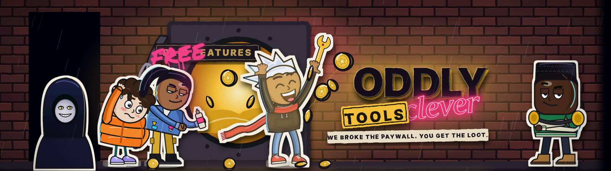

Hey, I build free tools for creators, because I got tired of every useful app wanting a monthly subscription.

No account, no paywall, no catch. Everything here is open source.

If one of my tools saved you time, a tea keeps the next one coming.

### What I've built

| Tool | What it does |
| --- | --- |
| [**OddlyCleverEditor**](https://github.com/oddlyclevertools/OddlyCleverEditor) | Free captions and 9:16 Shorts cuts that run offline on your own NVIDIA GPU. No watermark. |
| [**Clearpane**](https://github.com/oddlyclevertools/clearpane) | A small ad and tracker blocker for Chrome. No account, no data collection. |
| [**OddlyClever Design**](https://github.com/oddlyclevertools/OddlyCleverDesign) | A free design app in your browser for thumbnails, Shorts covers, posters and social posts. Background remover on your own GPU. [Use it now](https://oddlyclevertools.github.io/OddlyCleverDesign/). |

### See them work

I post real screen recordings of every tool on YouTube: [**@oddlyclevertools**](https://www.youtube.com/@oddlyclevertools)

Something broken, or a feature you want? Open an issue on the tool's repo. I read every one.
